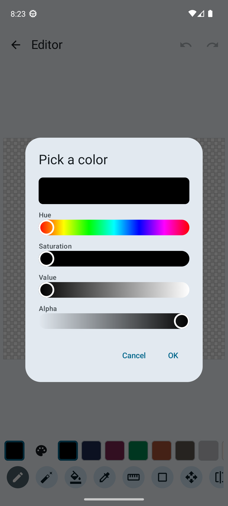
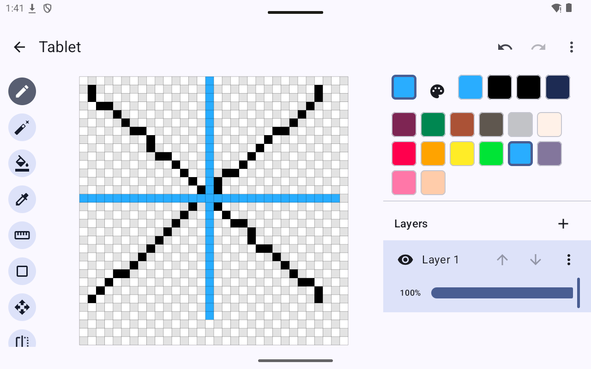

# 🎨 Pixela

**Pixel art en la palma de tu mano** 
*Pixel art in the palm of your hand*

  

[Español](#español) · [English](#english)

 &nbsp;  &nbsp;  &nbsp; 

## Español

Pixela es un editor de pixel art para dibujar con el dedo. Elige un lienzo de 16, 32 o 64 píxeles, coge el lápiz y crea sprites, iconos o lo que se te ocurra. Cuando acabes, expórtalo como imagen nítida a cualquier tamaño.

### ✨ Qué puedes hacer

- ✏️ **Dibujar con todas las herramientas** que necesitas: lápiz, goma, bote de pintura, cuentagotas, líneas, rectángulos y modo espejo.
- 🔍 **Acercarte con dos dedos** para trabajar píxel a píxel con una cuadrícula que aparece al hacer zoom.
- ↩️ **Deshacer y rehacer** sin miedo a equivocarte.
- 🗂️ **Trabajar por capas**: añadir, ocultar, reordenar, cambiar su opacidad y combinarlas.
- 🎨 **Elegir colores** de una paleta de 16, de tus recientes o con un selector completo con transparencia.
- 🖼️ **Guardar todos tus proyectos** en una galería con miniaturas; se guardan solos mientras dibujas.
- 📤 **Exportar a PNG** a 1x, 4x, 8x o 16x sin que se emborrone, y compartirlo directamente.
- 📥 **Importar una imagen** como capa nueva para calcarla o retocarla.
- 📱 **Móvil y tablet**: en pantallas grandes, herramientas, paleta y capas siempre a mano. Con teclado, Ctrl+Z también funciona.

---

## English

Pixela is a pixel art editor made for drawing with your finger. Pick a 16, 32 or 64 pixel canvas, grab the pencil and make sprites, icons or whatever comes to mind. When you are done, export it as a crisp image at any size.

### ✨ What you can do

- ✏️ **Draw with every tool you need**: pencil, eraser, paint bucket, eyedropper, lines, rectangles and mirror mode.
- 🔍 **Pinch to zoom** and work pixel by pixel, with a grid that shows up as you zoom in.
- ↩️ **Undo and redo** without fear of mistakes.
- 🗂️ **Work in layers**: add, hide, reorder, change opacity and merge them.
- 🎨 **Pick colours** from a 16-colour palette, your recent ones, or a full picker with transparency.
- 🖼️ **Keep all your projects** in a gallery with thumbnails; they save themselves while you draw.
- 📤 **Export to PNG** at 1x, 4x, 8x or 16x without blurring, and share it straight away.
- 📥 **Import a picture** as a new layer to trace or touch up.
- 📱 **Phone and tablet**: on large screens tools, palette and layers are always at hand. With a keyboard, Ctrl+Z works too.

---

Parte de mi portfolio de apps Android · Part of my Android app portfolio 
<a href="https://github.com/basd1/bitacora">Bitácora</a> · <a href="https://github.com/basd1/intervalo">Intervalo</a> · <a href="https://github.com/basd1/onda">Onda</a> · <a href="https://github.com/basd1/pixela">Pixela</a> · <a href="https://github.com/basd1/lupa">Lupa</a>

