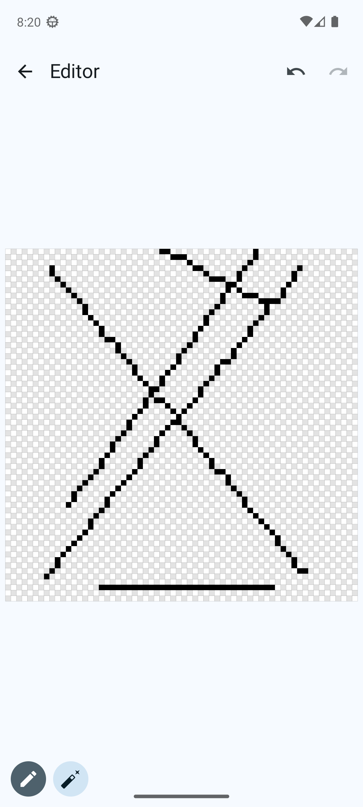
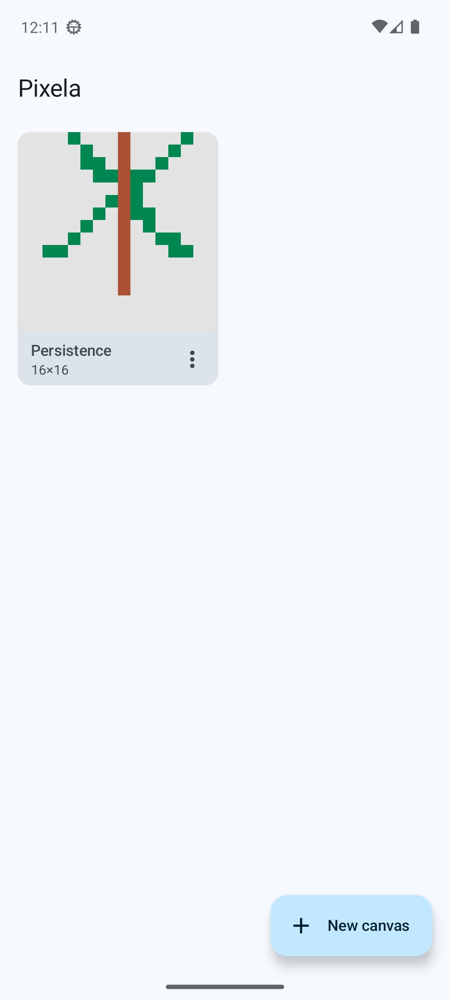
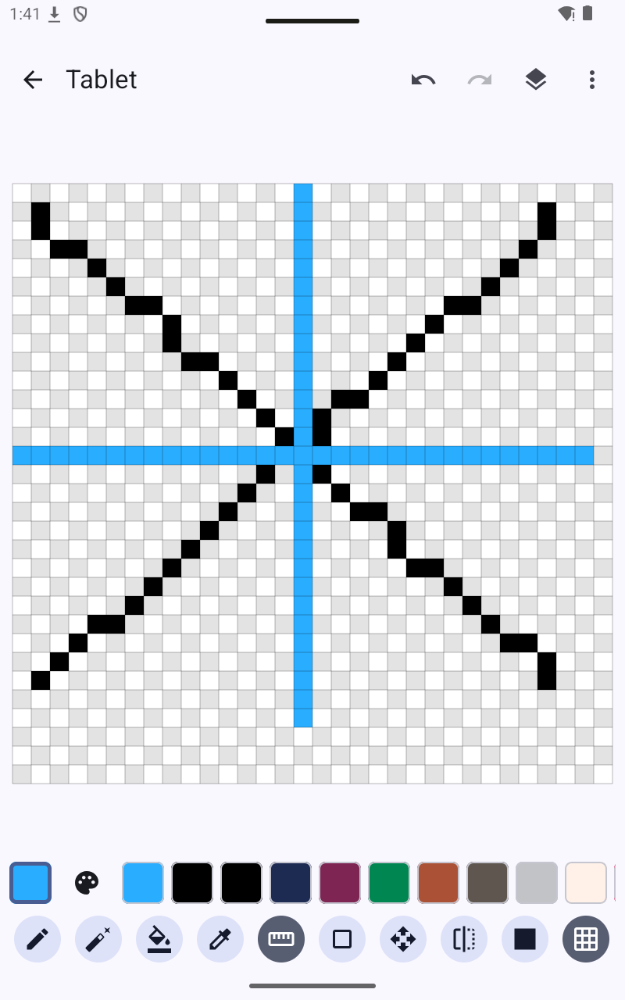
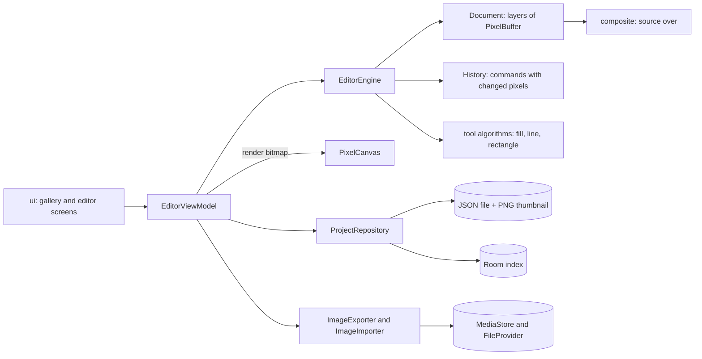
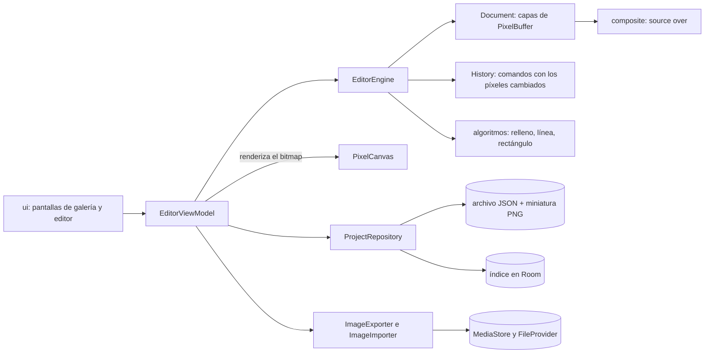

# Pixela

[English](#english) · [Español](#español)

## English

A pixel art editor for Android. Small canvases (16, 32 or 64 pixels a side), layers, undo and redo, the usual drawing tools and PNG export. Everything is drawn by hand on a Compose `Canvas`; there is no drawing library.

The point of the project is custom UI: a canvas that stays sharp and fast, gestures that tell drawing from zooming, a non-trivial editing model with a command history, and a layout that adapts from a phone to a tablet.

100% Kotlin and Jetpack Compose (Material 3).

> **Status:** built, unit-tested (106 tests, including Compose UI tests under Robolectric), linted (no errors) and exercised on an Android API 33 phone emulator (`portfolio_phone`) and a tablet emulator (`medium_tablet`). See [Known limitations](#known-limitations) for what was not checked.

### Screenshots

| | | |
|---|---|---|
|  |  |  |
| Pencil on a zoomed canvas | Tools, palette and colors | Layers sheet with opacity |
|  |  |  |
| Gallery after the app was killed | Tablet, landscape: tools left, palette and layers right | Same project in portrait: state kept, compact layout |

More in `docs/capturas/`: the bucket and move tools, the color picker, hidden and reordered layers, and the new-project dialog.

### Features

- **Tools:** pencil, eraser, flood fill, eyedropper, line, rectangle (outline or filled), move layer content, and a horizontal mirror for pencil and eraser. A fast stroke joins consecutive finger positions with a line, so there are no gaps. Line and rectangle show a live preview while dragging.
- **Canvas:** checkerboard behind transparency, a pixel grid that appears when zoomed in, pinch to zoom and two-finger pan. A second finger that lands during a stroke cancels it without leaving a mark.
- **Layers:** add, delete, duplicate, rename, reorder, hide, opacity, merge down. All of them go through the same undo history as strokes.
- **Colors:** a 16-color default palette, recent colors, and a color picker (hue, saturation, value, alpha) built in Compose.
- **Projects:** gallery grid with thumbnails; create (name and size), duplicate, rename, delete. Autosave while editing and when leaving.
- **Export and import:** PNG at 1×, 4×, 8× or 16× (nearest neighbour) to the gallery, or share it. Import a small image as a new layer, reduced to fit the canvas.
- **Adaptive:** windows 840 dp wide or more get a tool rail on the left and palette plus layers always visible on the right; narrower windows get a bottom toolbar and a layers sheet. Rotation keeps the document, zoom, tool and history. `Ctrl/Cmd+Z` undoes, `Ctrl/Cmd+Shift+Z` and `Ctrl/Cmd+Y` redo.
- Light and dark theme, dynamic color on Android 12+, edge-to-edge, English and Spanish.

### Build and run

Requirements: JDK 17 and the Android SDK (`compileSdk` 36). Create `local.properties` with your `sdk.dir`.

```bash
./gradlew assembleDebug testDebugUnitTest lintDebug
```

On Windows use `.\gradlew.bat`. Install `app/build/outputs/apk/debug/app-debug.apk` on a device or emulator (`minSdk` 26). To draw from a script, `adb shell input swipe x1 y1 x2 y2 300` makes a stroke.

### Architecture

Layers per package: `domain` (pure Kotlin: buffer, layers, composition, tool algorithms, history, project format; no Android types), `data` (Room index, project files, image export and import), `ui` (Compose screens and ViewModels), `di` (Koin modules). Room entities never leave `data`.



#### The editing model

- `PixelBuffer` is a width, a height and an `IntArray` of ARGB colors. `Layer` adds an id, name, visibility and opacity. `Document` holds the size, the ordered layers, the active layer and the palette.
- `composite(document)` is a pure function: it blends the visible layers bottom to top with "source over" alpha, honoring layer opacity, into one `IntArray`.
- Every change is a `Command` that stores only what changed: pixel indexes with the old and new value for strokes, fills and moves, and the small description of the change for layer operations (add, delete, move, update properties, merge down). A whole stroke is one command. `History` keeps undo and redo stacks capped at 100 steps; a new change clears the redo stack.
- `EditorEngine` applies tools to the document and records commands. It knows nothing about Android, so it is tested with plain JUnit.
- `Viewport` is a pure mapping between screen and canvas coordinates (scale and offset, with fit and clamp), tested at several zooms and offsets.

#### Project files

A project is a JSON file in internal storage plus a thumbnail PNG next to it. Room stores only the index: id, name, size, modification time and the thumbnail path. Each layer's pixels are stored run-length encoded (`count`, `color` pairs) and then Base64, which keeps a mostly empty 64×64 layer to a few characters. The file has a `version` field so the format can change later. A missing or damaged file shows an error in the editor instead of crashing.

### Performance

A stroke on a 64×64 canvas with 8 layers should not recompose the editor, so:

- **One bitmap, drawn scaled.** The composition is rendered into a single `Bitmap` with one pixel per canvas pixel and drawn with `FilterQuality.None`. Nothing draws a rectangle per pixel on each frame. The grid is only drawn when the zoom is high enough for it to be useful.
- **The bitmap is regenerated only when pixels change.** The engine bumps a `revision` number on each change. The canvas reads it in the draw phase and renders again only when it moved, so panning and zooming never touch the pixels.
- **Canvas state lives outside the composables that do not need it.** Zoom and pan are in `CanvasState` (owned by the ViewModel, so rotation keeps it) and are read only in the draw phase and the gesture code. The `StateFlow<EditorUiState>` that drives the toolbar, palette and layers does not change while a stroke moves; only `revision` does, and only the canvas reads it. A stroke redraws the canvas without recomposing the rest of the editor.
- **Undo stores deltas.** A command keeps changed pixels only, never a copy of the canvas, so 100 steps of history stay small.
- **Flood fill is iterative** (an explicit stack), so a fill on the whole canvas cannot overflow the call stack.

### Decisions

- **Koin instead of Hilt.** Kotlin-first dependency injection, the same choice as in the other apps of the portfolio. Koin 4.2.2.
- **Window width from the configuration, not a library.** `material3-adaptive` or the window size class would work too, but the layout needs a single breakpoint (840 dp), so it reads `LocalConfiguration.screenWidthDp`, which is per window and updates on rotation and resize. One dependency less.
- **Layers panel is shared.** The same `LayersPanel` is shown in a bottom sheet on narrow windows and inline on wide ones; the tool and palette rows have a stacked variant built on the same button lists, so the two layouts cannot drift apart.
- **Autosave on a timer plus on leaving.** An 800 ms debounce after the last change, and an immediate save when the editor stops or is disposed. Saves run on an application-scoped coroutine scope so leaving the screen does not cancel them.
- **The composite decides the thumbnail and the export.** Both are rendered from `composite(document)`, so what you see is what you export. The export scales with nearest neighbour.
- **Export without permissions where possible.** `MediaStore` on API 29 and later; on API 26 to 28 the app asks for `WRITE_EXTERNAL_STORAGE` first. Sharing writes a PNG in the cache folder and hands out a `FileProvider` URI with clip data, so the system chooser can read the preview.
- **Import keeps the aspect ratio.** A larger image is sampled down while decoding, scaled to fit inside the canvas and centred; the rest stays transparent.
- **Recent colors in DataStore;** projects are not stored in DataStore or Room because they are files.
- Discarded: drawing a rectangle per pixel on each frame and saving a full copy of the canvas per undo step (both too slow or too memory-hungry; see Performance).

### Known limitations

- Not tried on a real phone. How a stroke and a pinch feel under a finger cannot be judged from an emulator.
- Export on API 26 to 28 (with `WRITE_EXTERNAL_STORAGE`) was not run; only API 33 was.
- The importer's Robolectric test does not catch the bug found by hand (`decodeStream` returns `null` when only decoding bounds, which is correct on a device but not in Robolectric's shadow). That path is covered only by running the app.
- No instrumented tests (`connectedAndroidTest`); the Compose UI tests run under Robolectric.
- Undo history is not saved with the project: it starts empty each time a project is opened.
- Out of scope: frame animation, selection and copy-paste, canvases larger than 64, pressure-sensitive pens.

---

## Español

Un editor de pixel art para Android. Lienzos pequeños (16, 32 o 64 píxeles de lado), capas, deshacer y rehacer, las herramientas de dibujo habituales y exportación a PNG. Todo se dibuja a mano sobre un `Canvas` de Compose; no hay ninguna librería de dibujo.

El objetivo del proyecto es la interfaz a medida: un lienzo que se mantiene nítido y rápido, gestos que distinguen entre dibujar y hacer zoom, un modelo de edición no trivial con historial de comandos y un diseño que se adapta del móvil a la tablet.

100 % Kotlin y Jetpack Compose (Material 3).

> **Estado:** compilada, con tests unitarios (106, incluidos tests de UI de Compose con Robolectric), lint sin errores y probada en un emulador de móvil con Android API 33 (`portfolio_phone`) y en un emulador de tablet (`medium_tablet`). En [Limitaciones conocidas](#limitaciones-conocidas) está lo que no se ha comprobado.

### Capturas

| | | |
|---|---|---|
|  |  |  |
| Lápiz sobre el lienzo con zoom | Herramientas, paleta y colores | Panel de capas con opacidad |
|  |  |  |
| La galería después de matar la app | Tablet en horizontal: herramientas a la izquierda, paleta y capas a la derecha | El mismo proyecto en vertical: se conserva el estado, diseño compacto |

Hay más en `docs/capturas/`: las herramientas de relleno y mover, el selector de color, capas ocultas y reordenadas, y el diálogo de proyecto nuevo.

### Funciones

- **Herramientas:** lápiz, goma, relleno, cuentagotas, línea, rectángulo (contorno o relleno), mover el contenido de la capa y espejo horizontal para el lápiz y la goma. En un trazo rápido, las posiciones consecutivas del dedo se unen con una línea, así que no quedan huecos. La línea y el rectángulo muestran una vista previa mientras se arrastra.
- **Lienzo:** fondo de cuadros detrás de la transparencia, una cuadrícula de píxeles que aparece al acercar, pellizcar para hacer zoom y desplazar con dos dedos. Si un segundo dedo toca la pantalla durante un trazo, el trazo se cancela sin dejar marca.
- **Capas:** añadir, borrar, duplicar, renombrar, reordenar, ocultar, opacidad y combinar con la de abajo. Todas pasan por el mismo historial de deshacer que los trazos.
- **Colores:** una paleta de 16 colores por defecto, colores recientes y un selector de color (tono, saturación, valor y alfa) hecho en Compose.
- **Proyectos:** galería en cuadrícula con miniaturas; crear (nombre y tamaño), duplicar, renombrar y borrar. Guardado automático durante la edición y al salir.
- **Exportar e importar:** PNG a 1×, 4×, 8× o 16× (vecino más cercano) a la galería, o compartirlo. Importar una imagen pequeña como capa nueva, reducida para que quepa en el lienzo.
- **Adaptable:** en ventanas de 840 dp de ancho o más hay un raíl de herramientas a la izquierda y la paleta y las capas siempre visibles a la derecha; en ventanas más estrechas, una barra de herramientas abajo y un panel de capas desplegable. Al girar se conservan el documento, el zoom, la herramienta y el historial. `Ctrl/Cmd+Z` deshace; `Ctrl/Cmd+Shift+Z` y `Ctrl/Cmd+Y` rehacen.
- Tema claro y oscuro, color dinámico en Android 12+, edge-to-edge, inglés y español.

### Compilar y ejecutar

Requisitos: JDK 17 y el SDK de Android (`compileSdk` 36). Crea `local.properties` con tu `sdk.dir`.

```bash
./gradlew assembleDebug testDebugUnitTest lintDebug
```

En Windows usa `.\gradlew.bat`. Instala `app/build/outputs/apk/debug/app-debug.apk` en un dispositivo o emulador (`minSdk` 26). Para dibujar desde un script, `adb shell input swipe x1 y1 x2 y2 300` hace un trazo.

### Arquitectura

Capas por paquete: `domain` (Kotlin puro: búfer, capas, composición, algoritmos de las herramientas, historial y formato de proyecto; sin tipos de Android), `data` (índice en Room, archivos de proyecto, exportación e importación de imágenes), `ui` (pantallas de Compose y ViewModels), `di` (módulos de Koin). Las entidades de Room nunca salen de `data`.



#### El modelo de edición

- `PixelBuffer` es un ancho, un alto y un `IntArray` de colores ARGB. `Layer` añade un id, un nombre, la visibilidad y la opacidad. `Document` guarda el tamaño, las capas en orden, la capa activa y la paleta.
- `composite(document)` es una función pura: mezcla las capas visibles de abajo arriba con alfa "source over", respetando la opacidad de cada capa, en un único `IntArray`.
- Cada cambio es un `Command` que guarda solo lo que ha cambiado: los índices de los píxeles con el valor antiguo y el nuevo en trazos, rellenos y movimientos, y una pequeña descripción del cambio en las operaciones de capas (añadir, borrar, mover, cambiar propiedades, combinar con la de abajo). Un trazo entero es un solo comando. `History` mantiene las pilas de deshacer y rehacer con un máximo de 100 pasos; un cambio nuevo vacía la pila de rehacer.
- `EditorEngine` aplica las herramientas al documento y registra los comandos. No sabe nada de Android, así que se prueba con JUnit sin más.
- `Viewport` es una correspondencia pura entre coordenadas de pantalla y de lienzo (escala y desplazamiento, con ajuste y límites), probada con varios niveles de zoom y desplazamientos.

#### Archivos de proyecto

Un proyecto es un archivo JSON en el almacenamiento interno más una miniatura PNG a su lado. Room guarda solo el índice: id, nombre, tamaño, fecha de modificación y ruta de la miniatura. Los píxeles de cada capa se guardan con codificación por longitud de serie (pares `count`, `color`) y después en Base64, con lo que una capa de 64×64 casi vacía ocupa unos pocos caracteres. El archivo tiene un campo `version` para que el formato pueda cambiar más adelante. Si un archivo falta o está dañado, el editor muestra un error en lugar de cerrarse.

### Rendimiento

Un trazo en un lienzo de 64×64 con 8 capas no debería recomponer el editor, así que:

- **Un solo bitmap, dibujado a escala.** La composición se renderiza en un único `Bitmap` con un píxel por cada píxel del lienzo y se dibuja con `FilterQuality.None`. Nada dibuja un rectángulo por píxel en cada fotograma. La cuadrícula solo se dibuja cuando el zoom es lo bastante alto como para que sea útil.
- **El bitmap solo se regenera cuando cambian los píxeles.** El motor incrementa un número `revision` en cada cambio. El lienzo lo lee en la fase de dibujo y solo vuelve a renderizar cuando ha cambiado, así que desplazar y hacer zoom nunca tocan los píxeles.
- **El estado del lienzo queda fuera de los composables que no lo necesitan.** El zoom y el desplazamiento están en `CanvasState` (que pertenece al ViewModel, así que sobrevive al giro) y solo se leen en la fase de dibujo y en el código de gestos. El `StateFlow<EditorUiState>` que controla la barra de herramientas, la paleta y las capas no cambia mientras se mueve un trazo; solo cambia `revision`, y solo lo lee el lienzo. Un trazo vuelve a dibujar el lienzo sin recomponer el resto del editor.
- **Deshacer guarda diferencias.** Un comando guarda solo los píxeles cambiados, nunca una copia del lienzo, así que 100 pasos de historial ocupan poco.
- **El relleno es iterativo** (con una pila explícita), así que rellenar el lienzo entero no puede desbordar la pila de llamadas.

### Decisiones

- **Koin en lugar de Hilt.** Inyección de dependencias pensada para Kotlin, la misma elección que en las demás apps del portfolio. Koin 4.2.2.
- **El ancho de la ventana sale de la configuración, no de una librería.** `material3-adaptive` o las clases de tamaño de ventana también servirían, pero el diseño necesita un único punto de corte (840 dp), así que lee `LocalConfiguration.screenWidthDp`, que es por ventana y se actualiza al girar y al redimensionar. Una dependencia menos.
- **El panel de capas es compartido.** El mismo `LayersPanel` se muestra en un panel inferior en ventanas estrechas y en línea en las anchas; las filas de herramientas y de paleta tienen una variante apilada construida con las mismas listas de botones, así que los dos diseños no pueden desincronizarse.
- **Guardado automático con temporizador y al salir.** Un retardo de 800 ms tras el último cambio y un guardado inmediato cuando el editor se detiene o se destruye. Los guardados se ejecutan en un ámbito de corrutinas de la aplicación, así que salir de la pantalla no los cancela.
- **La composición decide la miniatura y la exportación.** Las dos se renderizan con `composite(document)`, así que lo que ves es lo que exportas. La exportación escala con vecino más cercano.
- **Exportar sin permisos cuando se puede.** `MediaStore` en API 29 y posteriores; en API 26 a 28 la app pide antes `WRITE_EXTERNAL_STORAGE`. Compartir escribe un PNG en la carpeta de caché y entrega una URI de `FileProvider` con clip data, para que el selector del sistema pueda leer la vista previa.
- **Importar conserva la proporción.** Una imagen más grande se reduce al decodificarla, se escala para que quepa en el lienzo y se centra; el resto queda transparente.
- **Colores recientes en DataStore;** los proyectos no se guardan en DataStore ni en Room porque son archivos.
- Descartado: dibujar un rectángulo por píxel en cada fotograma y guardar una copia completa del lienzo por cada paso de deshacer (lo primero es demasiado lento y lo segundo gasta demasiada memoria; ver Rendimiento).

### Limitaciones conocidas

- No se ha probado en un móvil real. Cómo se sienten un trazo y un pellizco con el dedo no se puede valorar en un emulador.
- No se ha probado la exportación en API 26 a 28 (con `WRITE_EXTERNAL_STORAGE`); solo en API 33.
- El test de Robolectric del importador no detecta el bug que se encontró a mano (`decodeStream` devuelve `null` cuando solo se decodifican los límites, lo cual es correcto en un dispositivo pero no en el shadow de Robolectric). Esa ruta solo está cubierta ejecutando la app.
- No hay tests instrumentados (`connectedAndroidTest`); los tests de UI de Compose se ejecutan con Robolectric.
- El historial de deshacer no se guarda con el proyecto: empieza vacío cada vez que se abre un proyecto.
- Fuera de alcance: animación por fotogramas, selección y copiar y pegar, lienzos de más de 64 y lápices sensibles a la presión.
