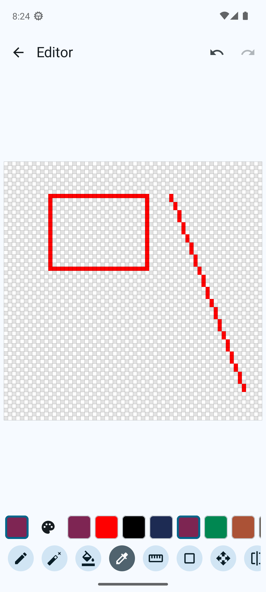
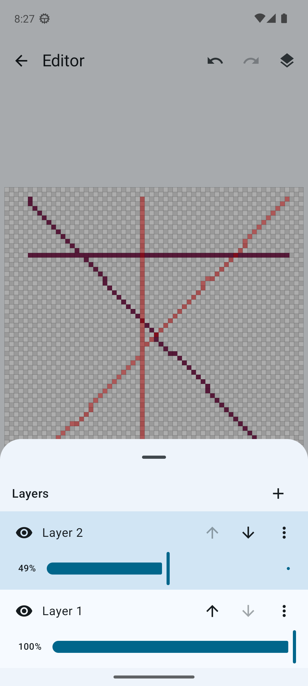
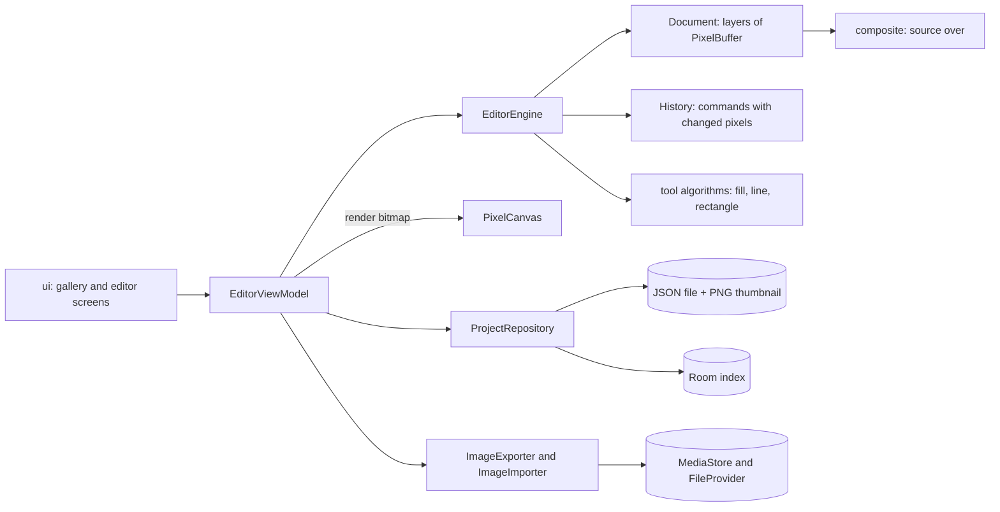

# Pixela

A pixel art editor for Android. Small canvases (16, 32 or 64 pixels a side), layers, undo and redo, the usual drawing tools and PNG export. Everything is drawn by hand on a Compose `Canvas`; there is no drawing library.

The point of the project is custom UI: a canvas that stays sharp and fast, gestures that tell drawing from zooming, a non-trivial editing model with a command history, and a layout that adapts from a phone to a tablet.

100% Kotlin and Jetpack Compose (Material 3).

> **Status:** built, unit-tested (106 tests, including Compose UI tests under Robolectric), linted (no errors) and exercised on an Android API 33 phone emulator (`portfolio_phone`) and a tablet emulator (`medium_tablet`). See [Known limitations](#known-limitations) for what was not checked.

## Screenshots

| | | |
|---|---|---|
|  |  |  |
| Pencil on a zoomed canvas | Tools, palette and colors | Layers sheet with opacity |
|  |  |  |
| Gallery after the app was killed | Tablet, landscape: tools left, palette and layers right | Same project in portrait: state kept, compact layout |

More in `docs/capturas/`: the bucket and move tools, the color picker, hidden and reordered layers, and the new-project dialog.

## Features

- **Tools:** pencil, eraser, flood fill, eyedropper, line, rectangle (outline or filled), move layer content, and a horizontal mirror for pencil and eraser. A fast stroke joins consecutive finger positions with a line, so there are no gaps. Line and rectangle show a live preview while dragging.
- **Canvas:** checkerboard behind transparency, a pixel grid that appears when zoomed in, pinch to zoom and two-finger pan. A second finger that lands during a stroke cancels it without leaving a mark.
- **Layers:** add, delete, duplicate, rename, reorder, hide, opacity, merge down. All of them go through the same undo history as strokes.
- **Colors:** a 16-color default palette, recent colors, and a color picker (hue, saturation, value, alpha) built in Compose.
- **Projects:** gallery grid with thumbnails; create (name and size), duplicate, rename, delete. Autosave while editing and when leaving.
- **Export and import:** PNG at 1×, 4×, 8× or 16× (nearest neighbour) to the gallery, or share it. Import a small image as a new layer, reduced to fit the canvas.
- **Adaptive:** windows 840 dp wide or more get a tool rail on the left and palette plus layers always visible on the right; narrower windows get a bottom toolbar and a layers sheet. Rotation keeps the document, zoom, tool and history. `Ctrl/Cmd+Z` undoes, `Ctrl/Cmd+Shift+Z` and `Ctrl/Cmd+Y` redo.
- Light and dark theme, dynamic color on Android 12+, edge-to-edge, English and Spanish.

## Build and run

Requirements: JDK 17 and the Android SDK (`compileSdk` 36). Create `local.properties` with your `sdk.dir`.

```bash
./gradlew assembleDebug testDebugUnitTest lintDebug
```

On Windows use `.\gradlew.bat`. Install `app/build/outputs/apk/debug/app-debug.apk` on a device or emulator (`minSdk` 26). To draw from a script, `adb shell input swipe x1 y1 x2 y2 300` makes a stroke.

## Architecture

Layers per package: `domain` (pure Kotlin: buffer, layers, composition, tool algorithms, history, project format; no Android types), `data` (Room index, project files, image export and import), `ui` (Compose screens and ViewModels), `di` (Koin modules). Room entities never leave `data`.



### The editing model

- `PixelBuffer` is a width, a height and an `IntArray` of ARGB colors. `Layer` adds an id, name, visibility and opacity. `Document` holds the size, the ordered layers, the active layer and the palette.
- `composite(document)` is a pure function: it blends the visible layers bottom to top with "source over" alpha, honoring layer opacity, into one `IntArray`.
- Every change is a `Command` that stores only what changed: pixel indexes with the old and new value for strokes, fills and moves, and the small description of the change for layer operations (add, delete, move, update properties, merge down). A whole stroke is one command. `History` keeps undo and redo stacks capped at 100 steps; a new change clears the redo stack.
- `EditorEngine` applies tools to the document and records commands. It knows nothing about Android, so it is tested with plain JUnit.
- `Viewport` is a pure mapping between screen and canvas coordinates (scale and offset, with fit and clamp), tested at several zooms and offsets.

### Project files

A project is a JSON file in internal storage plus a thumbnail PNG next to it. Room stores only the index: id, name, size, modification time and the thumbnail path. Each layer's pixels are stored run-length encoded (`count`, `color` pairs) and then Base64, which keeps a mostly empty 64×64 layer to a few characters. The file has a `version` field so the format can change later. A missing or damaged file shows an error in the editor instead of crashing.

## Performance

A stroke on a 64×64 canvas with 8 layers should not recompose the editor, so:

- **One bitmap, drawn scaled.** The composition is rendered into a single `Bitmap` with one pixel per canvas pixel and drawn with `FilterQuality.None`. Nothing draws a rectangle per pixel on each frame. The grid is only drawn when the zoom is high enough for it to be useful.
- **The bitmap is regenerated only when pixels change.** The engine bumps a `revision` number on each change. The canvas reads it in the draw phase and renders again only when it moved, so panning and zooming never touch the pixels.
- **Canvas state lives outside the composables that do not need it.** Zoom and pan are in `CanvasState` (owned by the ViewModel, so rotation keeps it) and are read only in the draw phase and the gesture code. The `StateFlow<EditorUiState>` that drives the toolbar, palette and layers does not change while a stroke moves; only `revision` does, and only the canvas reads it. A stroke redraws the canvas without recomposing the rest of the editor.
- **Undo stores deltas.** A command keeps changed pixels only, never a copy of the canvas, so 100 steps of history stay small.
- **Flood fill is iterative** (an explicit stack), so a fill on the whole canvas cannot overflow the call stack.

## Decisions

- **Koin instead of Hilt (project owner's override of the guide).** Kotlin-first dependency injection, as in the other apps. Koin 4.2.2.
- **Window width from the configuration, not a library.** The guide allows `material3-adaptive` or the window size class; the layout needs a single breakpoint (840 dp), so it reads `LocalConfiguration.screenWidthDp`, which is per window and updates on rotation and resize. One dependency less.
- **Layers panel is shared.** The same `LayersPanel` is shown in a bottom sheet on narrow windows and inline on wide ones; the tool and palette rows have a stacked variant built on the same button lists, so the two layouts cannot drift apart.
- **Autosave on a timer plus on leaving.** An 800 ms debounce after the last change, and an immediate save when the editor stops or is disposed. Saves run on an application-scoped coroutine scope so leaving the screen does not cancel them.
- **The composite decides the thumbnail and the export.** Both are rendered from `composite(document)`, so what you see is what you export. The export scales with nearest neighbour.
- **Export without permissions where possible.** `MediaStore` on API 29 and later; on API 26 to 28 the app asks for `WRITE_EXTERNAL_STORAGE` first. Sharing writes a PNG in the cache folder and hands out a `FileProvider` URI with clip data, so the system chooser can read the preview.
- **Import keeps the aspect ratio.** A larger image is sampled down while decoding, scaled to fit inside the canvas and centred; the rest stays transparent.
- **Recent colors in DataStore;** projects are not stored in DataStore or Room because they are files.
- Discarded: drawing a rectangle per pixel on each frame and saving a full copy of the canvas per undo step (both ruled out by the guide; see Performance).

## Known limitations

- Not tried on a real phone. How a stroke and a pinch feel under a finger cannot be judged from an emulator.
- Export on API 26 to 28 (with `WRITE_EXTERNAL_STORAGE`) was not run; only API 33 was.
- The importer's Robolectric test does not catch the bug found by hand (`decodeStream` returns `null` when only decoding bounds, which is correct on a device but not in Robolectric's shadow). That path is covered only by running the app.
- No instrumented tests (`connectedAndroidTest`); the Compose UI tests run under Robolectric.
- Undo history is not saved with the project: it starts empty each time a project is opened.
- Out of scope: frame animation, selection and copy-paste, canvases larger than 64, pressure-sensitive pens.
